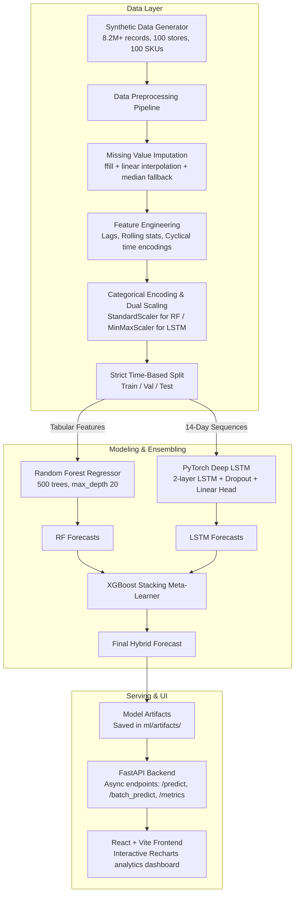

# PeriShield AI: Large-Scale Time-Series Forecasting System

[](https://opensource.org/licenses/MIT)
[](https://www.python.org/)
[](https://fastapi.tiangolo.com/)
[](https://pytorch.org/)
[](https://react.dev/)
[](https://www.docker.com/)

**PeriShield AI** is an enterprise-grade, end-to-end time-series forecasting system engineered to predict daily demand across large-scale retail supply chains dealing in perishable goods (produce, dairy, bakery, meat, deli, and floral).

---

## 🎯 Purpose and Problem Solved

### The Perishable Goods Dilemma
Retailers handling perishable items navigate a high-stakes balance:
* **Overstocking**: Results in rapid product expiration, massive food waste, and severe margin compression.
* **Understocking**: Leads to empty shelves, lost revenue opportunities, and frustrated customers.
* **Complex Demand Dynamics**: Daily demand is simultaneously driven by calendar cycles, day-of-week seasonality, national holidays, promotional lift, store traffic multipliers, and non-linear trend variations across thousands of SKU-to-Store pairs.

### The PeriShield AI Solution
PeriShield AI bridges tabular feature engineering and deep sequence learning using a **hybrid ensembling architecture**:
1. **Random Forest Forecaster**: Learns macro tabular associations across store dimensions, product categories, prices, and static metadata.
2. **PyTorch LSTM**: Ingests sequential 14-day temporal windows to capture autoregressive momentum and short-term volatility.
3. **XGBoost Stacking Meta-Learner**: Synthesizes the predictions of both base models to produce smoothed, high-confidence forecasts that significantly outperform naive baseline benchmarks.

---

## 🏗️ System Architecture



---

## 🛠️ Technical Stack

* **Machine Learning**: `scikit-learn` (Random Forest, Preprocessing), `PyTorch` (LSTM neural networks), `XGBoost` (Stacking meta-learner), `pandas`, `numpy`, `joblib`.
* **Backend API**: `FastAPI`, `Uvicorn`, `Pydantic v2`, `PyJWT` / `python-jose`, `python-multipart`.
* **Frontend**: `React 19`, `Vite`, `Recharts 3.8`, `Axios`, `Lucide React`, bespoke modern Vanilla CSS design system with curated dark-mode design tokens.
* **DevOps & Infrastructure**: `Docker`, `Docker Compose`, `NGINX` (reverse proxy), `PostgreSQL 15`.
* **Testing**: `pytest`, `pytest-asyncio`, `httpx`.

---

## 📁 Repository Structure

```
Large-Scale-Time-Series-Forecasting-System/
├── backend/                   # FastAPI REST API
│   ├── routes/                # API routers (auth, predictions, metrics, data, health)
│   ├── config.py              # Application settings & environment variables
│   ├── main.py                # FastAPI application entrypoint & lifespan loader
│   ├── model_loader.py        # ModelManager for artifact loading & inference
│   └── schemas.py             # Pydantic validation schemas
├── frontend/                  # React + Vite application
│   ├── src/
│   │   ├── pages/             # Dashboard, Forecast, Metrics, Holidays, DataManagement, Login
│   │   ├── components/        # Sidebar, Topbar navigation components
│   │   ├── api.js             # Axios client connecting to backend API
│   │   ├── App.jsx            # App layout shell
│   │   ├── main.jsx           # React DOM root with BrowserRouter
│   │   └── index.css          # Design system & responsive styles
│   ├── package.json           # Frontend dependencies
│   └── vite.config.js         # Vite bundler configuration
├── ml/                        # Machine Learning Pipeline
│   ├── models/                # Algorithms (random_forest.py, lstm.py, hybrid.py)
│   ├── artifacts/             # Serialized models & metadata (.gitkeep)
│   ├── data_generator.py      # Synthetic retail data generator
│   ├── preprocessing.py       # Custom transformers, scaling, sequence generation
│   ├── train.py               # End-to-end training pipeline orchestrator
│   ├── evaluate.py            # Model evaluation metrics & reporting
│   └── monitoring.py          # Category/store breakdowns & anomaly alerts
├── docker/                    # Docker containerization files
│   ├── Dockerfile.backend     # Python 3.11 backend container
│   ├── Dockerfile.frontend    # Multi-stage Node build + NGINX runtime
│   └── nginx.conf             # NGINX reverse proxy configuration
├── data/                      # Dataset directory (.gitkeep)
├── tests/                     # Unit test suite
│   └── test_pipeline.py       # Preprocessing, model, and API tests
├── .env.example               # Environment variables template
├── .gitignore                 # Comprehensive Git ignore rules
├── docker-compose.yml         # Container orchestration spec
├── requirements.txt           # Python backend & ML dependencies
├── LICENSE                    # MIT License
└── README.md                  # Project documentation
```

---

## 🚀 Quickstart Guide

### Prerequisites
* **Python 3.9+** (Python 3.11 recommended)
* **Node.js 20+** and **npm**
* **Docker & Docker Compose** (Optional, recommended for production)

---

### Method A: Local Development Setup

#### 1. Clone the Repository
```bash
git clone https://github.com/usha1101/Large-Scale-Time-Series-Forecasting-System.git
cd Large-Scale-Time-Series-Forecasting-System
```

#### 2. Configure Environment
```bash
# On Windows (PowerShell):
Copy-Item .env.example .env

# On Linux/macOS:
cp .env.example .env
```

#### 3. Python Virtual Environment Setup
```bash
# Create virtual environment
python -m venv venv

# Activate virtual environment
# Windows (PowerShell):
.\venv\Scripts\activate
# Linux/macOS:
source venv/bin/activate

# Install dependencies
pip install -r requirements.txt
```

#### 4. Generate Synthetic Data
Generate realistic perishable retail demand data spanning 100 stores and 100 SKUs (over 8 million rows):
```bash
python ml/data_generator.py
```
*Outputs `data/sales_data.csv`.*

#### 5. Train the Machine Learning Pipeline
Train the Random Forest, PyTorch LSTM, and XGBoost stacking meta-learner:
```bash
python ml/train.py
```
*Trained weights and encoders will be saved to `ml/artifacts/`.*

#### 6. Start the Backend API
```bash
uvicorn backend.main:app --host 0.0.0.0 --port 8000 --reload
```
* Swagger UI documentation: `http://localhost:8000/docs`
* Health check: `http://localhost:8000/api/health`

#### 7. Start the Frontend Dashboard
In a new terminal window:
```bash
cd frontend
npm install
npm run dev
```
* Open `http://localhost:5173`
* Login with:
  * **Username**: `admin`
  * **Password**: `admin123`

---

### Method B: Containerized Deployment (Docker Compose)

Deploy the complete stack (FastAPI backend, React frontend, NGINX proxy, and PostgreSQL database) with a single command:

```bash
docker-compose up --build -d
```

* **Frontend Dashboard**: `http://localhost:3000`
* **Backend API & Docs**: `http://localhost:8000/docs`
* **PostgreSQL Database**: `localhost:5432`

To tear down the containers:
```bash
docker-compose down
```

---

## 📊 API Reference

| Method | Endpoint | Description |
|---|---|---|
| `GET` | `/api/health` | Service health status and loaded model states. |
| `POST` | `/api/auth/login` | Authenticate user and issue JWT bearer token. |
| `POST` | `/api/predict` | Generate single SKU-store forecast for specified date range. |
| `POST` | `/api/batch_predict` | Batch predictions across multiple SKU-store combinations. |
| `GET` | `/api/metrics` | Retrieve model performance metrics (MAE, RMSE, MAPE, $R^2$). |
| `GET` | `/api/metrics/skus` | Retrieve list of available categories, SKUs, and stores. |
| `POST` | `/api/upload_data` | Upload new sales CSV/Excel dataset for forecasting. |
| `GET` | `/api/datasets` | List uploaded datasets. |

### Sample Prediction Request (`POST /api/predict`)
```json
{
  "sku": "dairy_whole_milk",
  "store_id": "store_001",
  "start_date": "2025-04-01",
  "end_date": "2025-04-07"
}
```

### Sample Prediction Response
```json
{
  "sku": "dairy_whole_milk",
  "store_id": "store_001",
  "model_used": "hybrid",
  "forecasts": [
    {
      "date": "2025-04-01",
      "predicted_demand": 84.5,
      "model_used": "hybrid",
      "confidence_lower": 71.8,
      "confidence_upper": 97.2
    }
  ]
}
```

---

## 🧪 Testing

Execute automated unit tests covering data preprocessing, model architectures, and API endpoints:

```bash
pytest tests/test_pipeline.py -v
```

---

## 📄 License

This project is licensed under the MIT License - see the [LICENSE](LICENSE) file for details.
